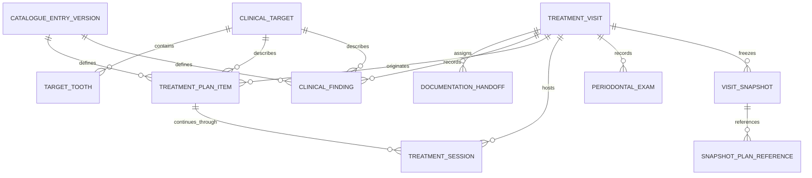

# Treatment service: SQL database and API implementation specification

Status: implementation blueprint; database and endpoints are not implemented by this document.

Reviewed against the repository on 2026-10-28.

## 1. Purpose and authority

Use this document to implement Treatment persistence, TypeORM migrations, application use cases, gRPC contracts, and API Gateway endpoints. It covers the current catalogue, semantic dental targets, patient-level treatment plans, work across visits, assistant documentation handoffs, findings, periodontal examinations, and audit history.

The implementation must preserve the latest local workspace behavior, especially **Start**, continuation across visits, and removal of an unstarted plan without a cancellation reason. This document also specifies backend requirements that local in-memory data cannot enforce: tenant isolation, transactions, concurrency, durable history, trusted actors, and request idempotency.

The following distinctions apply throughout:

| Label | Meaning |
| --- | --- |
| Current | Implemented in frontend/local treatment logic; backend adapters may still be missing |
| Required backend design | Proposed persistence or server behavior needed to support that logic safely |
| Pending policy | Requires a product/clinical decision before enabling the affected behavior; do not invent a clinical rule in SQL |

Source references:

- [Backend architecture](../../architecture/backend.md).
- [Treatment foundation](TREATMENT_FOUNDATION.md) and [earlier backend requirements](TREATMENT_BACKEND_REQUIREMENTS_PLAN.md).
- [Handoffs and longitudinal plans](treatment-handoff-and-longitudinal-plans.md).
- [Continuation across visits](treatment-continuation-across-visits.md).
- [Current types](../../../apps/frontend/src/features/treatment/model/treatment.ts).
- [Canonical local patient record](../../../apps/frontend/src/features/treatment/model/local-treatment-record.ts) and [visit operations](../../../apps/frontend/src/features/treatment/model/treatment-workspace.ts).
- [Catalogue](../../../apps/frontend/src/features/treatment/model/treatment-catalogue.ts), [typed inputs and validation](../../../apps/frontend/src/features/treatment/model/treatment-inputs.ts), and [target rules](../../../apps/frontend/src/features/treatment/model/treatment-targets.ts).
- [Periodontal model](../../../apps/frontend/src/features/treatment/model/periodontal.ts).
- [Existing backend foundation](../../../apps/backend/services/treatment-service/README.md) and [existing protobuf contract](../../../libs/contracts/treatment/src/lib/treatment.proto).

Where older documents or the current visit-centric protobuf conflict with the latest local rules, use the rules below when extending the backend. Update contracts deliberately; do not silently change the meaning of existing fields.

## 2. Architecture and storage decisions

### 2.1 Service ownership

Treatment owns its database, entities, repositories, migrations, and domain rules:

```text
apps/backend/services/treatment-service/src/treatment/
  domain/                         # Entities, invariants, repository interfaces
  application/                    # Commands, queries, authorization ports
  infrastructure/persistence/
    entities/                     # Service-local TypeORM entities
    migrations/                   # Service-local MySQL migrations
    repositories/                 # Repository implementations and mappers
  presentation/grpc/              # Transport adapters
```

Create folders only as their implementation is needed. Keep domain code independent of NestJS, TypeORM, and generated contracts. Use service-local layer aliases for cross-folder imports.

The browser uses Clinora's BFF/API client path. The Gateway authenticates, scopes requests, and calls Treatment through gRPC. Treatment makes clinical and lifecycle decisions. Publish asynchronous integration events through NATS with a transactional outbox when that integration is introduced.

Patient, clinic, appointment, chair, queue, and staff identifiers are **external references**, not cross-database foreign keys. Verify ownership and staff capabilities through trusted authorization context and application ports backed by gRPC. Never query another service's SQL database or import its entities.

### 2.2 SQL engine and conventions

The repository currently runs MySQL 8.4. Use:

```sql
CREATE DATABASE IF NOT EXISTS clinora_treatment
  CHARACTER SET utf8mb4 COLLATE utf8mb4_unicode_ci;
```

Use InnoDB, TypeORM migrations, and `synchronize: false`. Add database/user provisioning through the existing infrastructure convention when implementing the service; do not embed credentials in migrations or this specification.

| Convention | Required representation |
| --- | --- |
| Primary/domain identifier | `VARCHAR(36)` application-generated UUID; same type/collation on every FK |
| External identifier | `VARCHAR(36)` UUID; validate against the owning service/context |
| Timestamp | `DATETIME(6)`, UTC; transport as ISO 8601 with timezone |
| Optimistic version | `INT UNSIGNED NOT NULL DEFAULT 1` |
| Domain codes/statuses | `VARCHAR(64)` with case-sensitive `utf8mb4_bin` collation plus named `CHECK` constraints; TypeScript literal unions/enums |
| Boolean | `TINYINT(1)` with `CHECK (value IN (0,1))` when non-null |
| Clinical free text | `TEXT`; validate trimmed length, maximum 20,000 characters per field |
| Clinical detail collection | Validated `JSON` array of typed `{ key, value }` entries |
| Snapshot payload | Versioned, validated `JSON` object |
| Foreign-key deletion | `RESTRICT`; clinical removal is a domain command, not cascading deletion |

The lengths above are backend design limits, not existing UI guarantees. Enforce the same limits at DTO and service boundaries.

FK columns must have compatible types, character sets, and collations, and referenced composite keys must be explicitly unique. See [MySQL foreign-key requirements](https://dev.mysql.com/doc/refman/8.4/en/create-table-foreign-keys.html).

### 2.3 Main domain model



An individual catalogue act saved for a patient is a **treatment plan item**. There is no additional patient-wide “plan container” aggregate in the current product. Add one only if named plans, alternative proposals, or approvals at that level become real requirements.

A visit is an encounter/documentation record. A session records work on one plan item during one visit. A handoff delegates documentation for the whole visit; it does not represent treatment being performed.

## 3. Lifecycle rules

### 3.1 Visits and documentation

Persist current visit statuses exactly:

`DRAFT`, `IN_PROGRESS`, `AWAITING_REVIEW`, `READY_FOR_COMPLETION`, `COMPLETED`, `CANCELLED`.

| Trigger | Visit result | Handoff result |
| --- | --- | --- |
| Create encounter | `DRAFT` | None |
| Start encounter | `IN_PROGRESS` | None or existing assignment |
| Doctor assigns documentation | Remains open, usually `IN_PROGRESS` | `ASSIGNED` |
| Assigned assistant starts | Remains open | `IN_PROGRESS` |
| Assistant submits | `AWAITING_REVIEW` | `SUBMITTED` |
| Doctor returns documentation | `IN_PROGRESS` | `RETURNED`, required review text |
| Doctor accepts documentation | `READY_FOR_COMPLETION` | `ACCEPTED` |
| Doctor completes encounter | `COMPLETED` | None, `ACCEPTED`, or `CANCELLED` |

The doctor leaving the workspace or finishing the chairside consultation does **not** mean the visit is documentation-complete. An unresolved handoff keeps the visit open. There is currently no implemented `AWAITING_DOCUMENTATION` visit status. Build the assistant queue from handoff status and assignment, rather than pretending such a visit status exists.

Required backend addition: nullable `consultation_ended_at` can record the doctor ending the consultation while documentation is pending. Expose an explicit command for it if the product needs that action. It must not close sessions automatically or set `COMPLETED`. A future `AWAITING_DOCUMENTATION` status would require an explicit contract/UI migration.

Completing a visit requires the responsible dentist, an editable visit, resolved draft findings/acts/periodontal examination, no unresolved handoff, and no open sessions in that visit. Future work in `PLANNED` or `IN_PROGRESS` on patient-level plans does **not** block visit completion after current sessions have been closed.

Direct doctor documentation does not require an assistant handoff. A visit can complete directly from an editable state when all completion guards pass.

### 3.2 Plans: Start is the clinical action

| Action | Before | After | Meaning |
| --- | --- | --- | --- |
| Doctor adds catalogue act | No item | `PLANNED` | Proposed care, approved by that doctor; not performed |
| Assistant records act under handoff | No item | `DRAFT` | Unapproved documentation |
| Responsible dentist approves draft | `DRAFT` | `PLANNED` | Dentist approval; not treatment start or patient consent |
| Start session | `PLANNED` or `IN_PROGRESS` | `IN_PROGRESS` | Open session in the current visit |
| Close session, continue later | `IN_PROGRESS` | `IN_PROGRESS` | Work recorded; more visits needed |
| Close session, treatment finished | `IN_PROGRESS` | `COMPLETED` | Final treatment outcome recorded |
| Remove eligible unstarted item | Own direct `PLANNED` item | Tombstone | Discarded proposal; no reason required |
| Cancel | Eligible nonterminal item | `CANCELLED` | Required cancellation reason |
| Correct erroneous entry | Existing item, including completed | `ENTERED_IN_ERROR` | Required correction reason; retain history |

Do not add a separate Confirm step for doctor-created plans. Do not allow a generic status update to mark an act completed without a session/outcome.

**Removal eligibility must be checked by the server in a transaction:**

1. Actor is the responsible doctor for the editable origin visit and the author of the direct item.
2. Source is `DOCTOR_DIRECT`, status is `PLANNED`, and item is not already removed.
3. Same clinic and patient, current visit equals `origin_visit_id`.
4. No session exists for this plan in any visit, including cancelled sessions.
5. No finalized visit snapshot references the plan.

Removal sets `removed_at`, `removed_by_user_id`, increments version, and records `ACT_REMOVED` without a reason. Exclude the item from normal lists, charts, and timelines. Keep the tombstone for audit; do not show a cancelled row or physically delete it through the UI.

Once a session exists, free removal is forbidden. Cancellation/correction requires a nonblank reason. If a session is open in the current visit, close it as `CANCELLED` in the same transaction, with `outcome = NULL`, preserving its initial snapshot and previous note. Append the cancellation/correction explanation and write both audit entries. An open session in another visit produces a conflict; resolve it in that visit. Completed plans support correction, not cancellation.

Draft assistant entries are handled through the draft review/discard workflow and audited separately; the direct-plan Remove permission above must not grant arbitrary removal of another user's draft or signed records.

### 3.3 Sessions and longitudinal care

Session statuses: `IN_PROGRESS`, `COMPLETED`, `CANCELLED`.

Closed successful outcomes: `CONTINUE_LATER`, `TREATMENT_FINISHED`.

- Start requires an approved, nonremoved, nonterminal plan, a responsible doctor, and an editable current visit (`IN_PROGRESS` or `READY_FOR_COMPLETION`).
- At most one open session per plan across all visits.
- Preserve the local rule: at most one noncancelled session per plan per visit. A cancelled session may be retried with a new session ID.
- Store an immutable plan snapshot and plan version when starting. Never rewrite that snapshot after later plan changes.
- Closing requires a nonblank session note and the expected session version. `CONTINUE_LATER` closes today's work while retaining the same plan ID for the next visit.
- `TREATMENT_FINISHED` closes the session and completes the plan atomically.
- A session being `COMPLETED` means its documentation/work entry is closed. Only `TREATMENT_FINISHED` means the whole plan is complete.
- Later sessions must not alter closed sessions or finalized visit snapshots. Any later correction is an auditable addendum or plan correction.
- Starting a new visit must not clone unfinished plans or create sessions for every ongoing plan automatically.

Current local data is limited to one open workspace visit per patient. Do not add a database-wide unique “one open visit per patient” constraint without an explicit scheduling policy; sessions already prevent concurrent work on the same plan.

### 3.4 Handoffs

Handoff statuses: `ASSIGNED`, `IN_PROGRESS`, `SUBMITTED`, `RETURNED`, `ACCEPTED`, `CANCELLED`.

The doctor enters required free-text instructions and selects an authorized assistant in the same clinic. One visit may have historical handoffs, but only one unresolved handoff at a time. The handoff covers the visit, even when it produces several plans.

The assigned assistant may document only in `ASSIGNED`, `IN_PROGRESS`, or `RETURNED`. Submission locks assistant edits until the doctor returns it. Every assistant-created item carries `origin_handoff_id`, `entered_by_user_id`, and `source = ASSISTANT_HANDOFF`. It remains draft until dentist approval. Entering documentation never attributes clinical performance to the assistant automatically.

Acceptance requires all submitted draft items to be approved or explicitly resolved. Return requires actual review text supplied by the dentist. Persist instruction revisions, reassignment, submission, return, acceptance, and cancellation history. Reassignment cannot change the responsible dentist and must not erase the prior assignee or provenance of already-entered items.

Assistant queue inclusion is based on authorized `assigned_to_assistant_id` and unresolved statuses; `SUBMITTED` can appear in a separate read-only “Awaiting review” filter. `ACCEPTED`/`CANCELLED` are history.

## 4. Clinical targets and grouped teeth

### 4.1 Numbering and anatomy

The current odontogram uses positions `11..18`, `21..28`, `31..38`, `41..48`. Store `tooth_position` plus `dentition` (`PERMANENT` or `PRIMARY`) explicitly. Primary teeth currently reuse the same chart slots, limited to positions 1–5 within each quadrant. Native primary FDI values such as `51` and `85` are **not** accepted by the current model. A future native-FDI contract requires an explicit conversion and migration, not a silent remapping.

Use anatomical order for contiguity and display:

```text
UPPER: 18 17 16 15 14 13 12 11 21 22 23 24 25 26 27 28
LOWER: 48 47 46 45 44 43 42 41 31 32 33 34 35 36 37 38
```

Numeric sorting is not a valid contiguity test across the midline. Reject duplicate members, invalid positions, and mixed arches where the target requires one arch. Preserve meaningful member order.

### 4.2 Target kinds

| Kind | Required geometry | Forbidden/important constraints |
| --- | --- | --- |
| `MOUTH` | No tooth members; arch null | No surfaces/sites/entrances; no current act requires it |
| `ARCH` | Arch and explicit nonempty members in that arch | Do not expand the selection to all teeth automatically |
| `TOOTH` | One or more members | No surfaces/sites; multiple members share one lifecycle |
| `TOOTH_SURFACE` | Members with at least one surface each | Surface enum only |
| `TOOTH_REGION` | Members with regions represented by surfaces | Only `MESIAL`, `DISTAL`, `OCCLUSAL` |
| `INDEX_SURFACE` | Members with index surfaces | Only `BUCCAL`, `LINGUAL`, `MESIAL`, `DISTAL` |
| `PERIODONTAL_SITE` | Members with site codes | Only `MB`, `B`, `DB`, `ML`, `L`, `DL` |
| `FURCATION_ENTRANCE` | Members with entrance codes | Only `MESIAL`, `DISTAL`, `BUCCAL`, `LINGUAL`; tooth-specific applicability |
| `BRIDGE_SPAN` | Ordered same-arch members | Bridge rules below; member roles required in the new contract |

Surface enum: `BUCCAL`, `LINGUAL`, `MESIAL`, `DISTAL`, `OCCLUSAL`. The current renderer's incisal naming maps to semantic `OCCLUSAL`; no SVG path IDs, rendering layer names, or bridge connector IDs belong in SQL or API contracts.

Periodontal site `B` and furcation entrance `BUCCAL` belong to different vocabularies. Do not store their union in one ambiguous column.

### 4.3 One grouped plan versus independent plans

The current entry form creates **one plan item per save**, even when several teeth are selected. Those teeth share approval, status, sessions, cancellation, and completion. This must be visible to backend implementers and preserved by default.

| Example | Persistence and lifecycle |
| --- | --- |
| Filling on 16, occlusal | One plan, one member, one surface |
| Same filling proposal on 16 and 26 saved together | Current behavior: one plan, two members, shared lifecycle |
| Fillings on 16 and 26 to progress independently | Explicit batch creates two plan IDs; each has its own sessions/status |
| Bridge 13–12–11 | One compound plan; support/replacement members, shared lifecycle |
| Partial denture on selected missing positions | One arch plan containing exactly those members |
| Upper and lower removable prostheses | Two arch plans; optionally created by one batch command |
| Existing bridge already present before this care | A confirmed finding, not a newly performed plan |
| Plan continued at a later appointment | Same plan ID; new visit and new session |

An optional `creation_batch_id` correlates independently created items. It is not a plan container and does not own status. Batch creation must state `INDEPENDENT_ITEMS`; never split a bridge or other compound prosthesis automatically.

The old flat target applies the **same surfaces to every selected tooth**. A lossless adapter expands that cross-product. The new target contract allows surfaces per member; differing surfaces across teeth must use that contract or separate plans. Never flatten differing member surfaces into a misleading global union.

Partial completion of members in a grouped plan is not implemented. If tooth-level progress is needed, create independent plan items before work starts. Do not infer partial completion from notes or add per-member status fields without a separate feature decision.

### 4.4 Prosthesis and applicability rules

These are existing software selection rules, not a complete clinical treatment protocol:

- `BRIDGE` currently represents a tooth-supported fixed bridge: at least two contiguous same-arch positions, at least one confirmed missing tooth and at least one natural abutment; implant members are rejected by the full current validator. Primary dentition and conflicting removable-prosthesis ownership are rejected by related chart rules. Persist `ABUTMENT` and `PONTIC` roles, validate them against clinical state, and reject noncontiguous spans.
- A planned extraction does not make a tooth missing. Recheck confirmed findings/completed treatment state before accepting a bridge target and before starting work. Some current UI messaging/validators differ here; the server must use one consistent rule.
- Partial/complete removable dentures currently require nonempty same-arch selections of missing teeth, without natural or implant members. `COMPLETE_REMOVABLE_DENTURE` does not currently enforce 16 selected positions. The complete-arch definition is a pending clinical/product policy; do not silently expand a saved target.
- `HEALING_ABUTMENT` and `LOCATOR_ATTACHMENT` target implants. Locator overdenture selections represent implant support positions in an arch.
- Bar attachment/overdenture selection capabilities allow implant and missing positions, but exact minimum support counts, member roles, and compatibility rules are not fully specified. Keep them behind explicit supported policy before enabling a stronger backend workflow.
- Generic renderer capabilities are sometimes broad. They are not sufficient authority to allow an act on natural, missing, or implant states. Port semantic applicability into the Treatment domain and test each catalogue code.

Overlap/conflict detection must be symmetric: the same active code on an overlapping tooth/surface, or incompatible whole-tooth work overlapping surface work, requires explicit resolution. Do not silently overwrite another plan. Return the conflicting IDs and allow the dentist to remove an eligible proposal, cancel, or correct it. More detailed clinical compatibility matrices remain pending policy.

## 5. Catalogue baseline

### 5.1 Versioning

Catalogue entries are immutable semantic versions. Historical records reference the version used when entered. Deprecation prevents new selection but does not invalidate old plans or snapshots. Display names can be translated separately; stable codes and detail values drive logic.

Seed the initial 25 acts and 27 findings from the current definitions. Use a version identifier such as `treatment-catalogue-v1`. Store required/allowed detail rules and allowed targets with each version, while enforcing equivalent typed rules in the domain. Test seed/domain/contract parity. A database JSON schema is not an alternative to application validation.

### 5.2 Treatment acts — all 25 current entries

| Code | Category | Target | Required detail |
| --- | --- | --- | --- |
| `FISSURE_SEALING` | Preventive | `TOOTH_SURFACE` | None |
| `DIRECT_FILLING` | Restorative | `TOOTH_SURFACE` | `FILLING_MATERIAL` |
| `CROWN` | Restorative | `TOOTH` | `RESTORATION_MATERIAL` |
| `INLAY` | Restorative | `TOOTH` | `RESTORATION_MATERIAL` |
| `ONLAY` | Restorative | `TOOTH_SURFACE` | `RESTORATION_MATERIAL` |
| `VENEER` | Restorative | `TOOTH` | `RESTORATION_MATERIAL` |
| `CROWN_REPLACEMENT` | Restorative | `TOOTH` | `RESTORATION_MATERIAL` |
| `ROOT_CANAL_MEDICATION` | Endodontic | `TOOTH` | None |
| `ROOT_CANAL_FILLING` | Endodontic | `TOOTH` | None |
| `ROOT_CANAL_REPAIR` | Endodontic | `TOOTH` | None |
| `GLASS_FIBER_POST` | Endodontic | `TOOTH` | None |
| `METAL_POST` | Endodontic | `TOOTH` | None |
| `APICOECTOMY` | Endodontic | `TOOTH` | None |
| `PARAPULPAL_PIN` | Restorative | `TOOTH` | None |
| `EXTRACTION` | Surgery | `TOOTH` | None |
| `IMPLANT_PLACEMENT` | Implant | `TOOTH` | None |
| `HEALING_ABUTMENT` | Implant | `TOOTH` | None |
| `BRIDGE` | Prosthodontic | `BRIDGE_SPAN` | `RESTORATION_MATERIAL` |
| `LOCATOR_ATTACHMENT` | Prosthodontic | `TOOTH` | None |
| `LOCATOR_OVERDENTURE` | Prosthodontic | `ARCH` | None |
| `BAR_ATTACHMENT` | Prosthodontic | `TOOTH` | None |
| `BAR_OVERDENTURE` | Prosthodontic | `ARCH` | None |
| `PARTIAL_REMOVABLE_DENTURE` | Prosthodontic | `ARCH` | None |
| `COMPLETE_REMOVABLE_DENTURE` | Prosthodontic | `ARCH` | None |
| `ORTHODONTIC_APPLIANCE` | Orthodontic | `TOOTH` | `ORTHODONTIC_APPLIANCE` |

Detail values:

| Key | Values |
| --- | --- |
| `FILLING_MATERIAL` | `COMPOSITE`, `AMALGAM`, `GIC`, `TEMPORARY` |
| `RESTORATION_MATERIAL` | `ZIRCON`, `EMAX`, `METAL_CERAMIC`, `METAL`, `GOLD`, `GRADIA`, `TELESCOPE`, `TEMPORARY` |
| Material subset for `INLAY`, `ONLAY`, `VENEER` | `ZIRCON`, `EMAX`, `GOLD`, `GRADIA`, `TEMPORARY` |
| `ORTHODONTIC_APPLIANCE` | `BRACKET`, `BAND` |

The material subset is enforced in current UI selection and must also be enforced server-side. Do not accept every restoration material for every act merely because it belongs to the global enum.

### 5.3 Clinical findings — all 27 current entries

Findings describe observed/existing state and are not treatment plans.

| Code | Target | Required detail / qualification |
| --- | --- | --- |
| `TOOTH_STATE` | `TOOTH` | `TOOTH_STATE` |
| `TOOTH_SUBSTRATE` | `TOOTH` | `TOOTH_SUBSTRATE` |
| `CARIES` | `TOOTH_SURFACE` | `ICDAS_CARS_SEVERITY`; optional `CARIES_TYPE`, `RADIOGRAPHIC_DEPTH` |
| `ROOT_CARIES` | `TOOTH` | `ROOT_CARIES_STATE` |
| `EXISTING_FILLING` | `TOOTH_SURFACE` | `FILLING_MATERIAL`; optional `FILLING_DEFECT` |
| `EXISTING_FIXED_RESTORATION` | `TOOTH`, or `BRIDGE_SPAN` for bridge subtype | `RESTORATION_TYPE`, `RESTORATION_MATERIAL` |
| `EXISTING_ENDODONTIC_STATE` | `TOOTH` | `ENDODONTIC_STATE` |
| `EXISTING_PROSTHESIS` | `TOOTH` in current catalogue | `PROSTHESIS_TYPE`; arch/span expansion requires explicit subtype contract |
| `CALCULUS` | `TOOTH` | None |
| `CONTACT_POINT_DEFECT` | `TOOTH_SURFACE` | None |
| `TOOTH_FRACTURE` | `TOOTH_REGION` | None |
| `MOBILITY` | `TOOTH` | `MOBILITY_GRADE` |
| `PERIODONTAL_INVOLVEMENT` | `TOOTH` | None |
| `PERIAPICAL_LESION` | `TOOTH` | `PERIAPICAL_LESION_TYPE` |
| `EXTRACTION_WOUND` | `TOOTH` | None |
| `CROWN_LEAKAGE` | `TOOTH` | None |
| `PULP_DIAGNOSIS` | `TOOTH` | `PULP_DIAGNOSIS`; optional compatible `PULP_LATIN` |
| `APICAL_DIAGNOSIS` | `TOOTH` | `APICAL_DIAGNOSIS` |
| `ROOT_RESORPTION` | `TOOTH` | `ROOT_RESORPTION_TYPE` |
| `TOOTH_WEAR` | `TOOTH_SURFACE` | At least one wear detail, described below |
| `DISCOLORATION` | `TOOTH` | `DISCOLORATION_TYPE` |
| `ORTHODONTIC_STATE` | `TOOTH` | `ORTHODONTIC_STATE` |
| `PERI_IMPLANT_STATUS` | `TOOTH` | `PERI_IMPLANT_STATE`; implant applicability |
| `PERIODONTAL_MEASUREMENT` | `PERIODONTAL_SITE` | `PROBING_DEPTH_MM`; additional typed fields require validator alignment |
| `FURCATION_INVOLVEMENT` | `TOOTH` in current generic catalogue | `FURCATION_GRADE`; detailed exam stores entrances separately |
| `PLAQUE_FINDING` | `TOOTH_SURFACE` | Presence finding currently needs no detail; typed `PLAQUE_PRESENT` support requires validator alignment |
| `GINGIVAL_FINDING` | `TOOTH_SURFACE` | Current catalogue needs no detail; typed `GINGIVAL_INDEX` support requires validator alignment |

Finding detail vocabulary:

| Key | Values / type |
| --- | --- |
| `TOOTH_STATE` | `NATURAL`, `MISSING`, `IMPLANT`, `PRIMARY`, `UNDER_GUM`, `MISSING_AFTER_EXTRACTION`, `MISSING_CLOSED` |
| `TOOTH_SUBSTRATE` | `NATURAL`, `RADIX`, `BROKEN`, `CROWNPREP` |
| `ICDAS_CARS_SEVERITY` | Integer 1–6 |
| `CARIES_TYPE` | `PRIMARY`, `SUBCROWN` |
| `RADIOGRAPHIC_DEPTH` | `E1`, `E2`, `D1`, `D2`, `D3` |
| `ROOT_CARIES_STATE` | `ACTIVE`, `ARRESTED`, `ACTIVE_CAVITATED` |
| `FILLING_DEFECT` | `MARGINAL`, `FRACTURE`, `WEAR`; absence means no defect recorded |
| `RESTORATION_TYPE` | `CROWN`, `INLAY`, `ONLAY`, `VENEER`, `BRIDGE` |
| `ENDODONTIC_STATE` | `MEDICATION`, `ROOT_CANAL_FILLING`, `INCOMPLETE`, `GLASS_FIBER_POST`, `METAL_POST` |
| `PROSTHESIS_TYPE` | `HEALING_ABUTMENT`, `LOCATOR`, `LOCATOR_DENTURE`, `BAR`, `BAR_DENTURE`, `REMOVABLE_PARTIAL`, `REMOVABLE_FULL` |
| `MOBILITY_GRADE` | String `1`, `2`, `3` in generic findings |
| `PERIAPICAL_LESION_TYPE` | `GRANULOMA`, `CYST`, `ABSCESS` |
| `PULP_DIAGNOSIS` | `NORMAL`, `REVERSIBLE_PULPITIS`, `IRREVERSIBLE_PULPITIS`, `NECROSIS` |
| `APICAL_DIAGNOSIS` | `NORMAL`, `SYMPTOMATIC_APICAL_PERIODONTITIS`, `ASYMPTOMATIC_APICAL_PERIODONTITIS`, `ACUTE_APICAL_ABSCESS`, `CHRONIC_APICAL_ABSCESS`, `CONDENSING_OSTEITIS` |
| `ROOT_RESORPTION_TYPE` | `INTERNAL`, `EXTERNAL_CERVICAL` |
| `WEAR_EDGE_TYPE` | `ATTRITION`, `EROSION` |
| `WEAR_CERVICAL_TYPE` | `ABRASION`, `ABFRACTION`, `EROSION` |
| Legacy `WEAR_TYPE` | `ATTRITION`, `EROSION`, `ABRASION`, `ABFRACTION`; retain for old records |
| `DISCOLORATION_TYPE` | `TETRACYCLINE`, `FLUOROSIS`, `NONVITAL`, `EXTRINSIC`, `OTHER` |
| `ORTHODONTIC_STATE` | `BRACKET`, `BAND`, `MESIAL_DRIFT`, `DISTAL_DRIFT`, `EXTRUSION`, `INTRUSION`, `ROTATION` |
| `PERI_IMPLANT_STATE` | `HEALTHY`, `MUCOSITIS`, `MILD`, `MODERATE`, `SEVERE` |
| `PROBING_DEPTH_MM` | Integer 1–15 |
| `GINGIVAL_MARGIN_MM` | Signed integer −10–20, where accepted by the aligned measurement contract |
| `BOP`, `SUPPURATION`, `PLAQUE_PRESENT` | Boolean, where accepted by the aligned finding contract |
| `FURCATION_GRADE` | String `1`, `2`, `3`, `4` in generic findings |
| `GINGIVAL_INDEX` | String `0`, `1`, `2`, `3` in the generic typed finding vocabulary |

`PULP_LATIN` compatibility:

- `PULPA_SANA` → `NORMAL`.
- `HYPERAEMIA_PULPAE` → `REVERSIBLE_PULPITIS`.
- `PULPITIS_ACUTA_SEROSA`, `PULPITIS_ACUTA_PURULENTA`, `PULPITIS_CHRONICA_CLAUSA`, `PULPITIS_CHRONICA_ULCEROSA`, `PULPITIS_CHRONICA_HYPERPLASTICA` → `IRREVERSIBLE_PULPITIS`.
- `NECROSIS_PULPAE`, `GANGRAENA_PULPAE` → `NECROSIS`.

Wear edge and cervical details can coexist and must remain independent. Require at least one recognized wear detail; never collapse two locations into one value.

Reject unknown codes, unknown detail keys, duplicate keys, invalid scalar types, invalid enum values, missing required fields, and incompatible subtype/target combinations. Do not coerce string `"false"` into boolean or accept arbitrary client JSON as trusted clinical data.

## 6. SQL table dictionary

This is a logical schema specification, not a runnable migration. Every table, FK, unique key, and index below must become an explicit TypeORM migration and be verified against MySQL 8.4. Illustrative DDL follows in section 7.

### 6.1 Scope and shared column conventions

In the table definitions below:

- `ID` means `id VARCHAR(36) NOT NULL PRIMARY KEY`.
- `SCOPE` means `clinic_id VARCHAR(36) NOT NULL, patient_id VARCHAR(36) NOT NULL`.
- `TIMESTAMPS` means `created_at DATETIME(6) NOT NULL, updated_at DATETIME(6) NOT NULL`.
- `VERSION` means `version INT UNSIGNED NOT NULL DEFAULT 1`.
- Every table marked `ID + SCOPE` must have `UNIQUE (clinic_id, patient_id, id)` in addition to its PK.
- Every FK between patient-owned tables includes `(clinic_id, patient_id, referenced_id)` referencing that composite unique key. Carry scope through child rows, not just root queries.
- Unless explicitly nullable (`NULL`), fields are `NOT NULL`.
- Except for the global seeded catalogue and technical outbox, all rows carry clinic/patient scope; idempotency has clinic/actor scope and a checked patient reference in its payload.

Never rely on a UUID being hard to guess as authorization. Every repository lookup, lock, update, and list must include the authorized clinic and patient where applicable.

### 6.2 `catalogue_entry_versions`

Global Treatment-owned vocabulary; no patient or clinic FK.

| Column | Type / rule |
| --- | --- |
| `id` | UUID PK |
| `entry_kind` | `VARCHAR(16)`: `ACT`, `FINDING` |
| `code`, `vocabulary_version` | `VARCHAR(64)` each |
| `display_name`, `category` | `VARCHAR(200)`, `VARCHAR(64)` |
| `allowed_targets` | JSON array |
| `detail_schema` | JSON object describing required/optional keys, types, enums, subtype constraints |
| `applicability_policy_version` | `VARCHAR(64)` |
| `selectable` | Boolean; availability metadata may change, semantic payload may not |
| `created_at` | `DATETIME(6)` |

Unique `(entry_kind, code, vocabulary_version)`. Index `(entry_kind, selectable, code)`. Record references remain valid after deprecation. Validate referenced entry kind in the use case; a FK alone cannot distinguish act from finding.

### 6.3 Patient mutation scope and `treatment_visits`

`treatment_patient_records` is a small Treatment-owned coordination row: `clinic_id UUID`, `patient_id UUID`, `version INT UNSIGNED DEFAULT 1`, and `TIMESTAMPS`, with composite PK `(clinic_id, patient_id)`. It is not a copy of the Patient service's record and contains no demographics. Visit and target roots reference this scope with a composite FK.

Create it idempotently after verifying patient/clinic access. Lock it first for every clinical mutation in that patient scope and increment its version on commit. This deliberately serializes short patient mutations: overlapping plan creation, tooth-state validation, session start, and sign-off must not race across different visits or different plan IDs. This is needed because a unique open-session key alone only protects work on the same plan. Do not create a separate service or patient-wide plan aggregate for this coordination row.

`treatment_visits`:

`ID + SCOPE + TIMESTAMPS + VERSION`.

| Additional column | Type / rule |
| --- | --- |
| `responsible_dentist_id` | UUID external staff reference |
| `appointment_id`, `queue_entry_id`, `chair_id` | UUID external references, NULL |
| `status` | Visit status from section 3 |
| `chief_complaint`, `clinical_notes` | TEXT, NULL |
| `created_by_user_id` | UUID external reference |
| `started_at`, `consultation_ended_at`, `completed_at`, `cancelled_at` | `DATETIME(6)`, NULL |
| `completed_by_user_id`, `cancelled_by_user_id` | UUID, NULL |
| `cancellation_reason` | TEXT, NULL; required if cancelled |

Indexes `(clinic_id, patient_id, created_at, id)`, `(clinic_id, responsible_dentist_id, status, updated_at, id)`, `(clinic_id, appointment_id)`, `(clinic_id, queue_entry_id)`.

Appointment/queue references are not unique by default: repeat or corrective visits must not be accidentally forbidden. If launch must be idempotent, use a launch idempotency key or explicitly agreed external encounter identity.

### 6.4 `documentation_handoffs`

`ID + SCOPE + TIMESTAMPS + VERSION`.

| Additional column | Type / rule |
| --- | --- |
| `visit_id` | Scoped FK → `treatment_visits` |
| `status` | Handoff status |
| `assigned_by_dentist_id`, `assigned_to_assistant_id` | UUID external staff references |
| `instruction_text` | TEXT, trimmed nonblank |
| `review_note` | TEXT, NULL; nonblank when returned/cancelled |
| `revision` | `INT UNSIGNED`, starts at 1 |
| `assigned_at` | `DATETIME(6)` |
| `submitted_at`, `reviewed_at`, `cancelled_at` | `DATETIME(6)`, NULL |
| `reviewed_by_user_id` | UUID, NULL |
| `unresolved_visit_id` | Stored generated nullable UUID; visit ID for statuses other than `ACCEPTED`, `CANCELLED` |

Unique `(clinic_id, patient_id, unresolved_visit_id)`. Index `(clinic_id, assigned_to_assistant_id, status, updated_at, id)` for assistant queue and `(clinic_id, patient_id, visit_id, created_at, id)` for visit history.

### 6.5 `documentation_handoff_revisions`

`ID + SCOPE`.

Fields: `handoff_id` scoped FK, `revision INT UNSIGNED`, `action VARCHAR(64)`, `status VARCHAR(64)`, `instruction_text TEXT`, `review_note TEXT NULL`, `assigned_to_assistant_id UUID`, `actor_user_id UUID`, `created_at DATETIME(6)`.

Unique `(clinic_id, patient_id, handoff_id, revision)`. Append-only; full revision text and assignment are retained, not just a mutable latest note. Write revision and current handoff in one transaction. Use actions `ASSIGNED`, `REVISED`, `REASSIGNED`, `STARTED`, `SUBMITTED`, `RETURNED`, `ACCEPTED`, `CANCELLED`.

### 6.6 `clinical_targets`

`ID + SCOPE`; fields `kind VARCHAR(64)`, `arch VARCHAR(8) NULL`, `created_at DATETIME(6)`.

Targets are immutable value records inside Treatment. A plan/finding edit creates a new target and switches its reference under version control. Old snapshots/audit retain the old target. Do not create a shared target service or library.

### 6.7 Target child tables

All use `ID + SCOPE`; their foreign keys are scoped.

| Table | Fields and constraints |
| --- | --- |
| `clinical_target_teeth` | `target_id` FK, `tooth_position TINYINT UNSIGNED`, `dentition VARCHAR(16)`, `ordinal SMALLINT UNSIGNED`, `member_role VARCHAR(32)`; unique `(clinic_id, patient_id, target_id, tooth_position, dentition)` and `(clinic_id, patient_id, target_id, ordinal)` |
| `clinical_target_surfaces` | `target_tooth_id` FK, `surface VARCHAR(16)`; unique `(clinic_id, patient_id, target_tooth_id, surface)` |
| `clinical_target_periodontal_sites` | `target_tooth_id` FK, `site VARCHAR(4)`; unique `(clinic_id, patient_id, target_tooth_id, site)` |
| `clinical_target_furcation_entrances` | `target_tooth_id` FK, `entrance VARCHAR(16)`; unique `(clinic_id, patient_id, target_tooth_id, entrance)` |

Use `TARGET` for ordinary teeth, `ABUTMENT`/`PONTIC` for the supported bridge. `IMPLANT_SUPPORT` and `REPLACED_TOOTH` are proposed semantic roles for prosthesis contracts; enable them only with the corresponding approved applicability rules. Do not infer unsupported implant bridges from role extensibility.

Index target teeth `(clinic_id, patient_id, tooth_position, dentition, target_id)` for patient/tooth history. Target kind, child cardinality, matching arch, role compatibility, and canonical ordering are domain transaction invariants; row-level SQL checks cannot validate the whole geometry.

### 6.8 `treatment_plan_items`

`ID + SCOPE + TIMESTAMPS + VERSION`.

| Additional column | Type / rule |
| --- | --- |
| `catalogue_entry_version_id` | FK → global catalogue row of kind `ACT` |
| `target_id` | Scoped FK → `clinical_targets` |
| `origin_visit_id` | Scoped FK → `treatment_visits`; immutable |
| `origin_handoff_id` | Scoped FK → `documentation_handoffs`, NULL |
| `source` | `DOCTOR_DIRECT`, `ASSISTANT_HANDOFF` |
| `status` | Plan status from section 3 |
| `details` | JSON array of validated typed details |
| `note` | TEXT, NULL |
| `entered_by_user_id` | UUID external reference; immutable author |
| `approved_by_dentist_id`, `approved_at` | UUID and `DATETIME(6)`, NULL together |
| `performed_by_user_id` | UUID, NULL; final clinician summary, sessions remain authoritative for each encounter |
| `completed_at` | `DATETIME(6)`, NULL |
| `cancelled_at`, `cancelled_by_user_id`, `cancellation_reason` | Timestamp, UUID, TEXT, NULL until cancellation |
| `entered_in_error_at`, `entered_in_error_by_user_id`, `entry_error_reason` | Timestamp, UUID, TEXT, NULL until correction |
| `removed_at`, `removed_by_user_id` | Timestamp and UUID, NULL together |
| `creation_batch_id` | UUID, NULL; correlation only |

Indexes `(clinic_id, patient_id, removed_at, status, updated_at, id)`, `(clinic_id, patient_id, origin_visit_id)`, `(clinic_id, patient_id, origin_handoff_id)`, `(clinic_id, patient_id, target_id)`, `(clinic_id, patient_id, creation_batch_id)`.

Server checks: direct source has no handoff; assistant source requires a handoff from the same origin visit. The handoff must be assigned to the entering assistant at entry time; retain original provenance after reassignment. Never accept author, approval, performance, removed metadata, or status as arbitrary creation fields.

### 6.9 `clinical_findings`

`ID + SCOPE + TIMESTAMPS + VERSION`.

Fields: `visit_id` scoped FK, `origin_handoff_id` scoped FK NULL, `catalogue_entry_version_id` catalogue FK of kind `FINDING`, `target_id` scoped FK, `status VARCHAR(64)`, `details JSON`, `note TEXT NULL`, `entered_by_user_id UUID`, `verified_by_dentist_id UUID NULL`, `verified_at DATETIME(6) NULL`, `refutation_reason TEXT NULL`, `entered_in_error_at DATETIME(6) NULL`, `entry_error_reason TEXT NULL`, `removed_at DATETIME(6) NULL`, `removed_by_user_id UUID NULL`, `supersedes_finding_id` scoped self-FK NULL.

Statuses: `DRAFT`, `CONFIRMED`, `REFUTED`, `ENTERED_IN_ERROR`. Index `(clinic_id, patient_id, status, created_at, id)`, `(clinic_id, patient_id, visit_id)`, `(clinic_id, patient_id, target_id)`, `(clinic_id, patient_id, origin_handoff_id)`.

Doctor-entered findings start `CONFIRMED` with that dentist's verification; assistant-entered findings start `DRAFT` and require dentist confirmation. Only confirmed nonremoved findings affect the accepted chart. A finding from an earlier visit is referenced as baseline state, not copied into a new canonical finding. Corrections preserve the original and link any replacement using `supersedes_finding_id`; prevent cycles. Removing a draft and correcting an approved finding are distinct audited commands. An assistant may remove only their own unsigned draft in their editable assigned handoff; the backend retains a tombstone/audit even though the local array currently removes that draft directly.

### 6.10 `treatment_sessions`

`ID + SCOPE + TIMESTAMPS + VERSION`.

| Additional column | Type / rule |
| --- | --- |
| `plan_item_id` | Scoped FK → `treatment_plan_items` |
| `visit_id` | Scoped FK → `treatment_visits` |
| `origin_handoff_id` | Scoped FK → `documentation_handoffs`, NULL; provenance only |
| `status` | `IN_PROGRESS`, `COMPLETED`, `CANCELLED` |
| `outcome` | `CONTINUE_LATER`, `TREATMENT_FINISHED`, NULL while open or cancelled |
| `note` | TEXT, NULL while open; required when closed |
| `performed_by_user_id`, `entered_by_user_id` | UUID external references; distinguish clinical performance from documentation |
| `plan_version` | `INT UNSIGNED`; exact approved version used to start, before the start transition increments the canonical plan version |
| `plan_snapshot` | Immutable JSON object; schema version, plan ID/version, code/catalogue version, status, target, details, note, attribution |
| `started_at` | `DATETIME(6)` |
| `closed_at` | `DATETIME(6)`, NULL while open |
| `closed_by_user_id` | UUID, NULL while open |
| `open_plan_id` | Generated plan ID only when `IN_PROGRESS`, otherwise NULL |
| `noncancelled_plan_id` | Generated plan ID unless `CANCELLED`, otherwise NULL |

Unique `(clinic_id, patient_id, open_plan_id)` and `(clinic_id, patient_id, visit_id, noncancelled_plan_id)`. Index `(clinic_id, patient_id, plan_item_id, started_at, id)` and `(clinic_id, patient_id, visit_id, status, started_at, id)`.

Enforce status/outcome/timestamp combinations with checks. Cancelled sessions remain evidence that work was started; they never make the plan removable again. Closed rows cannot be edited by a generic update endpoint.

### 6.11 `visit_snapshots` and `visit_snapshot_plan_references`

`visit_snapshots`: `ID + SCOPE`; `visit_id` scoped FK, `snapshot_kind VARCHAR(16)` (`BASELINE`, `FINAL`, `ADDENDUM`), `sequence INT UNSIGNED`, `schema_version INT UNSIGNED`, `payload JSON`, `signed_by_dentist_id UUID NULL`, `created_at DATETIME(6)`.

Unique `(clinic_id, patient_id, visit_id, sequence)`. A generated nullable final-visit key with scoped uniqueness allows only one `FINAL` snapshot per visit. Later addenda append rows and reference the original snapshot in their payload; they never replace it.

`visit_snapshot_plan_references`: `ID + SCOPE`; `snapshot_id` scoped FK, `plan_item_id` scoped FK, `plan_version INT UNSIGNED`, `reference_kind VARCHAR(24)` (`BASELINE`, `ORIGIN`, `SESSION`). Unique `(clinic_id, patient_id, snapshot_id, plan_item_id)`; precedence is `SESSION`, then `ORIGIN`, then `BASELINE` when multiple apply. Index `(clinic_id, patient_id, plan_item_id, snapshot_id)`.

Baseline freezes accepted clinical state at visit start. Final freezes findings, referenced plan versions, session outcomes, periodontal data, handoff decision, notes, dentist attribution, and relevant catalogue/display version information at sign-off. Its plan set is the union of baseline plan references, nonremoved plans originating in this visit, and plans with a session in this visit. Merely browsing a patient plan list does not attach every plan to the visit. Attaching a different preexisting proposal without a session is not a current feature; add explicit visit-plan linkage and a command if that becomes a requirement.

Store a final plan reference for each nonremoved proposal originating in this visit even if it has no session. This prevents later free removal from erasing a signed proposal. Use these indexed references to check Remove eligibility; do not scan every JSON snapshot.

For `BASELINE` references in the final snapshot, retain the baseline payload/version instead of looking up today's canonical version. For work documented in this visit, freeze the version visible at signing. If both apply, the payload may retain both baseline and encounter representations while the indexed reference records the encounter version. Cancelled visits also retain a `FINAL` snapshot of their recorded content; final here means the encounter is closed, not that treatment succeeded.

The current `TreatmentVisit.acts` array becomes a compatibility read projection from the appropriate snapshot and/or current visit links. It is never another canonical plan store.

### 6.12 `periodontal_exams`

`ID + SCOPE + TIMESTAMPS + VERSION`.

Fields: `visit_id` scoped FK, `origin_handoff_id` scoped FK NULL, `status VARCHAR(16)` (`DRAFT`, `CONFIRMED`), `entered_by_user_id UUID`, `verified_by_dentist_id UUID NULL`, `verified_at DATETIME(6) NULL`, `risk_context JSON` validated object.

Unique `(clinic_id, patient_id, visit_id)` for the current single exam per visit. Signed corrections belong in addenda/replacement versions, not silent edits of confirmed data. Prior examinations remain history; copying forward must be an explicit new examination with provenance, not an implicit current measurement.

Risk keys: `age` (integer ≥0), `smokingStatus` (`NEVER`, `FORMER`, `CURRENT`, `UNKNOWN`), `cigarettesPerDay` (integer ≥0), `diabetesStatus` (`NONE`, `PRESENT`, `UNKNOWN`), `hba1c` (nonnegative finite number), `periodontalToothLoss` (integer ≥0), `maximumRadiographicBoneLossPercent` (0–100). Upper limits beyond these technical bounds need clinical approval. Missing means unrecorded. Derive current age from Patient when appropriate; retain the recorded exam-time context.

### 6.13 Periodontal detail tables

All use `ID + SCOPE` and scoped FKs. Child updates increment the parent exam version in the same transaction.

| Table | Fields / keys |
| --- | --- |
| `periodontal_exam_teeth` | `exam_id` FK, `tooth_position TINYINT UNSIGNED`, `dentition VARCHAR(16)`, `mobility_grade TINYINT UNSIGNED NULL` (1–3), `keratinized_gingiva_width_mm TINYINT UNSIGNED NULL` (0–15), `cej_visibility VARCHAR(16) NULL`, `root_concavity VARCHAR(8) NULL`, `gingival_phenotype VARCHAR(8) NULL`, `miller_class VARCHAR(4) NULL`; unique scoped `(exam_id, tooth_position, dentition)` |
| `periodontal_exam_sites` | `exam_tooth_id` FK, `site VARCHAR(4)` (six-site enum), `probing_depth_mm TINYINT UNSIGNED` (1–15), `gingival_margin_mm SMALLINT NULL` (−10–20), `bop` boolean, `suppuration` boolean; unique scoped `(exam_tooth_id, site)` |
| `periodontal_exam_furcations` | `exam_tooth_id` FK, `entrance VARCHAR(16)`, `grade TINYINT UNSIGNED` (1–4); unique scoped `(exam_tooth_id, entrance)` |
| `periodontal_exam_surface_indices` | `exam_tooth_id` FK, `surface VARCHAR(16)` (four index surfaces), `index_kind VARCHAR(32)`, `value TINYINT UNSIGNED`; unique scoped `(exam_tooth_id, surface, index_kind)` |

`index_kind` and values:

- `OLEARY_PLAQUE`: presence rows with value 1; false removes the row, matching the current set representation.
- `PLAQUE`, `GINGIVAL`, `PERI_IMPLANT_PLAQUE`, `PERI_IMPLANT_BLEEDING`: grades 1–3; current UI zero deletes the value. Missing is not evidence of a measured normal score. A future explicit zero/unrecorded distinction requires a contract change.

Validate furcation entrances by current tooth anatomy: upper molars (quadrants 1/2, positions 6–8) `MESIAL`, `DISTAL`, `BUCCAL`; lower molars (quadrants 3/4, positions 6–8) `BUCCAL`, `LINGUAL`; upper first premolars (position 4) `MESIAL`, `DISTAL`. Other positions currently expose none. Do not apply permanent anatomy rules to primary teeth without an approved policy.

Peri-implant indices require an implant target; other tooth/site applicability must follow the semantic examination rules. A missing/zero probing depth is not a normal measurement: provide an explicit delete command for a draft site. `gingival_margin_mm = NULL` differs from zero.

CAL is derived as `PD + (GM ?? 0)` to preserve current behavior. Return whether GM was actually recorded so this fallback is not confused with a measured zero. Derive summaries with a calculation version and explicit denominators. BOP uses charted sites; the current O'Leary denominator uses four surfaces per present natural tooth. Do not treat an empty exam's UI percentage as a measured negative result.

Do not persist CAL, averages, percentages, Cairo output, or automated classifications as authoritative measured fields. A signed snapshot may retain calculated display results with algorithm version. Current periodontal diagnosis/stage/grade/extent remains `NOT_CLINICALLY_APPROVED` and null; do not enable automatic classification from this schema.

### 6.14 `treatment_audit_events`

`ID + SCOPE`; fields `visit_id` scoped FK NULL, `resource_type VARCHAR(64)`, `resource_id UUID`, `action VARCHAR(64)`, `actor_user_id UUID`, `actor_role VARCHAR(64)`, `reason TEXT NULL`, `before_version INT UNSIGNED NULL`, `after_version INT UNSIGNED NULL`, `changes JSON`, `command_id UUID`, `occurred_at DATETIME(6)`.

Append-only. Index `(clinic_id, patient_id, occurred_at, id)`, `(clinic_id, patient_id, resource_type, resource_id, occurred_at, id)`, `(clinic_id, patient_id, visit_id, occurred_at, id)`, `(clinic_id, command_id)`.

Audit creation, approval, removal, start/closure, cancellation/correction, finding review, periodontal changes, handoff revisions, and visit signing/cancellation. `changes` retains relevant before/after values and affected IDs; no credentials or authentication tokens. A polymorphic resource reference has no generic FK, so application code must validate it. Audit history is not the primary state store.

### 6.15 `treatment_command_receipts`

Fields: `id UUID PK`, `clinic_id UUID`, `actor_user_id UUID`, `operation VARCHAR(64)`, `idempotency_key VARCHAR(128)` with `utf8mb4_bin` collation (opaque, case-sensitive), `request_hash CHAR(64)`, `result JSON`, `created_at DATETIME(6)`, `expires_at DATETIME(6)`.

Unique `(clinic_id, actor_user_id, operation, idempotency_key)`. Index `expires_at`. Persist receipt in the same transaction as a successful command. Same key and normalized request returns the original response; same key and different request returns conflict. The authorization/scope check still applies on replay. Set and document a retry window before enabling cleanup; a proposed operational default is 7 days, not a clinical retention policy.

### 6.16 `treatment_outbox_events`

Introduce with the first event-producing integration. Fields: `id UUID PK`, `clinic_id UUID`, `aggregate_type VARCHAR(64)`, `aggregate_id UUID`, `aggregate_version INT UNSIGNED`, `event_type VARCHAR(128)`, `schema_version INT UNSIGNED`, `payload JSON`, `occurred_at DATETIME(6)`, `published_at DATETIME(6) NULL`, `attempts INT UNSIGNED DEFAULT 0`, `next_attempt_at DATETIME(6)`, `last_error TEXT NULL`.

Index `(published_at, next_attempt_at, occurred_at, id)`. Persist events with domain changes in one transaction; publish after commit. Use event IDs for consumer deduplication and aggregate versions for ordering/staleness detection. Do not broadcast free-text clinical notes in general clinic events.

## 7. Important SQL constraint patterns

These fragments assume the dictionary tables and scalar checks already exist. They illustrate required migration behavior, not a complete executable schema.

### 7.1 Tenant-safe foreign keys

```sql
ALTER TABLE treatment_plan_items
  ADD CONSTRAINT uq_plan_scope UNIQUE (clinic_id, patient_id, id),
  ADD CONSTRAINT fk_plan_origin_visit
    FOREIGN KEY (clinic_id, patient_id, origin_visit_id)
    REFERENCES treatment_visits (clinic_id, patient_id, id)
    ON DELETE RESTRICT ON UPDATE RESTRICT;

ALTER TABLE treatment_sessions
  ADD CONSTRAINT fk_session_plan
    FOREIGN KEY (clinic_id, patient_id, plan_item_id)
    REFERENCES treatment_plan_items (clinic_id, patient_id, id)
    ON DELETE RESTRICT ON UPDATE RESTRICT;
```

Apply the same scope pattern to visit, target, handoff, exam, and snapshot references. A scoped handoff FK guarantees clinic/patient scope; the use case must additionally check it belongs to the specified origin visit.

### 7.2 One open session and one noncancelled session per visit

```sql
ALTER TABLE treatment_sessions
  ADD COLUMN open_plan_id VARCHAR(36)
    GENERATED ALWAYS AS (
      CASE WHEN status = 'IN_PROGRESS' THEN plan_item_id ELSE NULL END
    ) STORED,
  ADD COLUMN noncancelled_plan_id VARCHAR(36)
    GENERATED ALWAYS AS (
      CASE WHEN status <> 'CANCELLED' THEN plan_item_id ELSE NULL END
    ) STORED,
  ADD CONSTRAINT uq_session_open_plan
    UNIQUE (clinic_id, patient_id, open_plan_id),
  ADD CONSTRAINT uq_session_visit_plan
    UNIQUE (clinic_id, patient_id, visit_id, noncancelled_plan_id);
```

MySQL unique indexes allow multiple NULL values, making these constraints possible without a partial-index feature. Do not use `UNIQUE(plan_item_id, status)`; that would wrongly forbid later completed sessions. See [MySQL CREATE TABLE and unique index rules](https://dev.mysql.com/doc/refman/8.4/en/create-table.html).

Use the same nullable generated-key pattern for unresolved handoffs and a visit's final snapshot. Generated keys are implementation columns, not domain/API fields.

### 7.3 Session consistency

```sql
ALTER TABLE treatment_sessions
  ADD CONSTRAINT ck_session_status
    CHECK (status IN ('IN_PROGRESS', 'COMPLETED', 'CANCELLED')),
  ADD CONSTRAINT ck_session_outcome
    CHECK (
      (status = 'IN_PROGRESS' AND outcome IS NULL AND closed_at IS NULL
        AND closed_by_user_id IS NULL)
      OR
      (status = 'COMPLETED' AND outcome IS NOT NULL
        AND outcome IN ('CONTINUE_LATER', 'TREATMENT_FINISHED')
        AND closed_at IS NOT NULL AND closed_by_user_id IS NOT NULL
        AND note IS NOT NULL AND CHAR_LENGTH(TRIM(note)) > 0)
      OR
      (status = 'CANCELLED' AND outcome IS NULL AND closed_at IS NOT NULL
        AND closed_by_user_id IS NOT NULL
        AND note IS NOT NULL AND CHAR_LENGTH(TRIM(note)) > 0)
    ),
  ADD CONSTRAINT ck_session_time
    CHECK (closed_at IS NULL OR closed_at >= started_at),
  ADD CONSTRAINT ck_session_snapshot_object
    CHECK (JSON_TYPE(plan_snapshot) = 'OBJECT');
```

Also add status vocabularies, version positivity, details-array checks, removal-field pairing, completion/cancellation attribution pairing, valid tooth-position/dentition checks, and measurement bounds from the dictionary. A SQL `CHECK` cannot replace cross-row authorization, target cardinality, or lifecycle validation.

## 8. Transactions, versions, and command behavior

### 8.1 Common command envelope

Every mutation carries an idempotency key and expected versions of existing aggregates it changes. Derive actor, clinic, and capabilities from the authenticated trusted context, never from a browser-supplied role or `actorUserId`.

Use a consistent lock order: patient coordination row first, affected visits sorted by ID, then plans sorted by ID, then sessions/handoffs/exams; never reverse this order in another use case. Commands involving a plan's origin and current visit lock both in that order. The transaction examples below assume the patient row is already locked. Keep transactions short and do not call external services while holding database locks. Resolve external authorization inputs first, and recheck treatment-owned guards under lock.

Use transaction-scoped `SELECT ... FOR UPDATE` and versioned writes. These locks require a transaction and are held until commit/rollback; see [MySQL locking reads](https://dev.mysql.com/doc/refman/8.4/en/innodb-locking-reads.html). Bounded deadlock retries must repeat the whole transaction using the same idempotency key. Never use `SKIP LOCKED` to skip clinical guards.

Serialize mutations through the visit row to prevent assistant submission racing a last draft creation or visit completion racing a new session. Increment the visit version for its clinically relevant child mutations; increment plan/session/handoff/exam versions when those records change. Responses return all changed versions. Reading an unscoped entity and checking scope afterward is forbidden.

### 8.2 Create plan transaction

1. Check/claim idempotency receipt, lock the visit, check expected visit version, editable status, actor permission, and handoff assignment where relevant.
2. Load exact selectable catalogue version, validate target/details/applicability and plan overlaps against accepted clinical state.
3. Insert immutable target and children, then the canonical plan item. Doctor source starts `PLANNED` with doctor approval; assistant source starts `DRAFT` with handoff provenance.
4. Increment visit version, append audit, optional outbox, persist receipt, commit.

An independent batch does all item creation in one transaction and returns a complete result or no changes. Reject duplicate items in the request. Limit an initial batch to 100 items as a backend transport limit.

### 8.3 Start session transaction

1. Lock relevant visit rows and plan; check expected visit/plan versions and doctor permission.
2. Reject removed/terminal/draft/unapproved items; revalidate applicable target state and conflicts. Check no open session and no noncancelled session for this plan/visit.
3. Capture the approved pre-start plan version and immutable snapshot, matching the local implementation. Update the canonical plan to `IN_PROGRESS` and increment its version. Insert an `IN_PROGRESS` session with that captured version/snapshot, clinician attribution, and start time. Return both the captured `planVersion` and the new canonical plan version under distinct fields.
4. Increment visit version, append audit, receipt and optional outbox, commit.

Unique constraints resolve races even when two requests pass earlier reads. Translate their violations into domain conflicts. Never reuse a session belonging to another visit in a retry response.

### 8.4 Close session transaction

Lock visit, plan, and session; verify scope, expected versions, open status, clinician permission, nonblank note, and allowed outcome. Close session and increment version. For `TREATMENT_FINISHED`, complete the plan with performer/time; for `CONTINUE_LATER`, retain `IN_PROGRESS`. Increment the plan version consistently for either outcome and return the new versions. Session start snapshot remains unchanged.

An exact idempotent replay returns the original response. A different close outcome or note for an already closed session is a conflict, not an implicit edit.

### 8.5 Remove, cancel, and correct transactions

Remove locks origin/current visit and plan, checks the complete section 3.2 eligibility predicate, checks sessions and final snapshot references, writes tombstone/audit, and increments plan/visit versions. It must race safely against session start and visit finalization through the same plan/visit locks.

Cancel/correct locks affected visits and plan, finds/locks any open session, rejects a session in another visit, requires a reason, closes a current open session as cancelled, and changes plan status atomically. Preserve prior completed sessions and all snapshots. A terminal plan cannot be restarted. Further correction requires a new linked record or addendum.

### 8.6 Handoff submit/review and visit finalization

Submit locks visit/handoff, checks assigned assistant and versions, freezes assistant edits, sets `SUBMITTED`/`AWAITING_REVIEW`, records a revision/audit, commits.

Accept/return locks visit/handoff and affected drafts. Accept validates resolved drafts and sets `ACCEPTED`/`READY_FOR_COMPLETION`; return requires review text and sets `RETURNED`/`IN_PROGRESS`. Approvals are separate domain commands or an explicit atomic review operation with an enumerated list of decisions; never approve an unspecified set through a blind status change.

Finalize locks visit and relevant records, rechecks completion guards, inserts the immutable `FINAL` snapshot and indexed plan references, sets visit `COMPLETED`, records signer/time and audit, and commits. The snapshot and completion status must never be persisted in separate transactions.

### 8.7 Visit cancellation

Require the responsible dentist and a reason. Reject already completed visits; use addenda/corrections for signed records. Reject cancellation while sessions are open or a handoff is unresolved until those are explicitly resolved. Cancel the encounter without silently cancelling all patient-level plans or deleting completed work. Persist a cancellation snapshot/audit of already recorded content. Carrying plans into later visits remains possible when they are otherwise eligible.

## 9. API and gRPC surface

### 9.1 Contract conventions

The routes below are proposed Gateway routes under `/clinics/:clinicId/treatment`. Apply existing Gateway version/prefix conventions when wiring them. BFF adapters call these routes; they do not access SQL.

- IDs in path/body must be validated UUIDs and scoped server-side.
- Mutation headers include `Idempotency-Key`. Bodies include `expectedVisitVersion`, `expectedPlanVersion`, `expectedSessionVersion`, `expectedHandoffVersion`, or `expectedExamVersion` as applicable.
- Return resource IDs, changed versions, server timestamps, and resulting statuses. Never return persistence-generated helper columns.
- Lists use stable cursor pagination with a timestamp plus ID tie-breaker; default limit 25, maximum 100. Do not return all historical notes in queue summaries.
- Enum filters are validated; date ranges are UTC and bounded. Parameterized queries only, with whitelisted sort fields.
- `patientId` is required in the scoped request context even where omitted from a short route; the service resolves/validates it, rather than trusting a mismatched body.

### 9.2 Queries

| HTTP route suffix | Proposed RPC | Purpose |
| --- | --- | --- |
| `GET /catalogue` | `GetTreatmentCatalogue` | Versioned acts/findings, detail rules, supported target roles and availability |
| `GET /patients/:patientId/workspace?visitId=...` | `GetTreatmentWorkspace` | Current visit, patient plan projection, current sessions, handoff, exam, baseline and versions |
| `GET /patients/:patientId/visits` | `ListPatientTreatmentVisits` | Patient encounters with documentation state |
| `GET /visits/:visitId` | `GetTreatmentVisit` | Editable current detail or frozen historical snapshot |
| `GET /patients/:patientId/plan-items` | `ListPatientTreatmentPlanItems` | Filters: status, tooth position, dentition, origin visit, optional authorized history |
| `GET /plan-items/:planItemId` | `GetTreatmentPlanItem` | Plan detail and provenance |
| `GET /plan-items/:planItemId/sessions` | `ListTreatmentSessions` | Plan continuation history |
| `GET /patients/:patientId/timeline` | `GetPatientTreatmentTimeline` | Visits, sessions, significant clinical events; removed proposals omitted by default |
| `GET /handoffs?assignedTo=me&status=...` | `ListDocumentationHandoffs` | Authorized assistant queue, patient/visit summary and assignment state |
| `GET /visits/:visitId/handoffs` | `ListVisitDocumentationHandoffs` | Active and historical handoffs/revisions |
| `GET /visits/:visitId/periodontal-exam` | `GetPeriodontalExamination` | Measurements, verification, version, derived display summaries |
| `GET /patients/:patientId/audit` | `ListTreatmentAuditEvents` | Privileged scoped audit history |

Workspace returns accepted chart state and proposal overlays separately. `COMPLETED` visits return their frozen content; the patient plan endpoint returns latest canonical state. Label these semantics explicitly so the UI cannot accidentally replace history with current plan status.

### 9.3 Visit and handoff commands

| HTTP route suffix | Proposed RPC | Core request |
| --- | --- | --- |
| `POST /patients/:patientId/visits` | `CreateTreatmentVisit` | Responsible dentist, optional appointment/queue/chair, chief complaint |
| `POST /visits/:visitId/start` | `StartTreatmentVisit` | Expected visit version |
| `PATCH /visits/:visitId/notes` | `UpdateTreatmentVisitNotes` | Explicit chief complaint/clinical notes patch, expected version |
| `POST /visits/:visitId/end-consultation` | `EndTreatmentConsultation` | Proposed timestamp command; expected version |
| `POST /visits/:visitId/complete` | `CompleteTreatmentVisit` | Expected visit version; server checks all completion guards |
| `POST /visits/:visitId/cancel` | `CancelTreatmentVisit` | Reason, expected visit version |
| `POST /visits/:visitId/addenda` | `AddTreatmentVisitAddendum` | Required text/reason, original snapshot reference; append only |
| `POST /visits/:visitId/handoffs` | `AssignVisitDocumentation` | Assistant ID, required instructions, expected visit version |
| `PATCH /handoffs/:handoffId/instructions` | `ReviseVisitDocumentation` | Instructions, expected visit/handoff versions; only editable handoff states |
| `POST /handoffs/:handoffId/reassign` | `ReassignVisitDocumentation` | Assistant ID, reason, expected versions |
| `POST /handoffs/:handoffId/start` | `StartVisitDocumentation` | Expected visit/handoff versions |
| `POST /handoffs/:handoffId/submit` | `SubmitVisitDocumentation` | Expected visit/handoff versions |
| `POST /handoffs/:handoffId/review` | `ReviewVisitDocumentation` | `ACCEPT` or `RETURN`, review text required for return, expected versions |
| `POST /handoffs/:handoffId/cancel` | `CancelVisitDocumentation` | Reason, expected versions; retain entered items |

Cancelling a handoff does not silently approve/discard its drafts. Require explicit resolution of remaining drafts before visit completion. Reassignment after submission requires return/reopen through a deliberate workflow; do not unlock submitted documentation implicitly.

### 9.4 Plan and session commands

| HTTP route suffix | Proposed RPC | Core request |
| --- | --- | --- |
| `POST /visits/:visitId/plan-items` | `CreateTreatmentPlanItem` | Code/catalogue version, semantic target, typed details, optional note, expected visit version |
| `POST /visits/:visitId/plan-item-batches` | `CreateTreatmentPlanItemBatch` | `INDEPENDENT_ITEMS`, item requests, expected visit version |
| `PATCH /plan-items/:planItemId/proposal` | `UpdateTreatmentPlanProposal` | New target/details/note, expected visit/plan versions; own editable unstarted proposal only |
| `POST /plan-items/:planItemId/approve` | `ApproveTreatmentPlanItem` | Dentist decision, expected visit/plan versions |
| `POST /plan-items/:planItemId/remove` | `RemoveTreatmentPlanItem` | Context visit ID, expected visit/plan versions; no reason required if eligible |
| `POST /plan-items/:planItemId/discard-draft` | `DiscardDraftTreatmentPlanItem` | Explicit review/discard reason, expected versions; draft-only authorization |
| `POST /plan-items/:planItemId/cancel` | `CancelTreatmentPlanItem` | Context visit ID, reason, expected visit/plan version and open-session version if present |
| `POST /plan-items/:planItemId/enter-in-error` | `CorrectTreatmentPlanItem` | Context visit ID, reason, expected versions; preserve history |
| `POST /plan-items/:planItemId/sessions` | `StartTreatmentSession` | Current visit ID, expected visit/plan versions |
| `POST /sessions/:sessionId/close` | `CloseTreatmentSession` | Outcome, required note, expected visit/plan/session versions |
| `POST /sessions/:sessionId/cancel` | `CancelTreatmentSession` | Required reason, expected visit/plan/session versions |

Proposal editing is a required backend extension, not permission to rewrite signed data. Apply the same ownership/no-session/no-final-reference guards as removal. After work begins, clinically meaningful changes require explicit cancellation/correction and replacement, retaining session snapshots.

Cancelling only an open session keeps the plan `IN_PROGRESS` for a retry/continuation, unless a separate explicit command cancels the whole plan. It still prevents free plan removal. Do not make `DELETE` on a plan mean both removal and clinical cancellation.

### 9.5 Finding and periodontal commands

| HTTP route suffix | Proposed RPC | Core request |
| --- | --- | --- |
| `POST /visits/:visitId/findings` | `RecordClinicalFinding` | Catalogue/target/details/note, expected visit version |
| `POST /findings/:findingId/confirm` | `ConfirmClinicalFinding` | Expected visit/finding versions; responsible dentist |
| `POST /findings/:findingId/refute` | `RefuteClinicalFinding` | Reason, expected versions |
| `POST /findings/:findingId/remove-draft` | `RemoveDraftClinicalFinding` | Expected versions; only authorized unsigned draft |
| `POST /findings/:findingId/enter-in-error` | `CorrectClinicalFinding` | Reason, expected versions; optional separately created replacement |
| `POST /visits/:visitId/periodontal-exam` | `CreatePeriodontalExamination` | Expected visit version |
| `PATCH /periodontal-exams/:examId` | `UpdatePeriodontalExamination` | Typed bounded tooth/site/index/risk changes, expected visit/exam versions |
| `POST /periodontal-exams/:examId/sites/remove` | `RemovePeriodontalSite` | Tooth/dentition/site, expected versions |
| `POST /periodontal-exams/:examId/confirm` | `ConfirmPeriodontalExamination` | Expected visit/exam versions; responsible dentist |

Draft periodontal changes are transactional patches, not replacement of the entire patient record. A confirmed exam is immutable; signed corrections use the addendum workflow and retain original measurements. The patch contract distinguishes omitted fields, explicit nulls, false, and zero.

### 9.6 Authorization and errors

| Actor | Allowed scope |
| --- | --- |
| Responsible dentist | Clinical entry, approval, start/close, correction/cancellation, handoff review, visit completion |
| Assigned dental assistant | Read assigned visit/handoff; create/edit permitted draft documentation in editable handoff states; submit |
| Other clinic staff/admin | Only explicitly granted operational/read capabilities; no automatic dentist approval rights |

Normalize existing external role strings such as `doctor`/`dental_assistant` at the trusted boundary. Do not trust request roles, assignee IDs as proof of permission, or the local demo actor. Actor attribution is server-generated. Delegation of clinical sign-off to another dentist requires an explicit future policy; do not let any doctor sign another's visit by default.

| Domain error | HTTP | gRPC |
| --- | --- | --- |
| Invalid target/detail/reason | 400 | `INVALID_ARGUMENT` |
| Missing authentication | 401 | `UNAUTHENTICATED` |
| Missing capability | 403 | `PERMISSION_DENIED` |
| Unknown resource in authorized scope | 404 | `NOT_FOUND` |
| Stale expected version | 409 | `ABORTED` |
| Open session, overlap, closed visit, unresolved handoff, unavailable catalogue version | 409 | `FAILED_PRECONDITION` |
| Idempotency key reused with different request | 409 | `ALREADY_EXISTS` |
| Dependency unavailable | 503 | `UNAVAILABLE` |

Include a stable application error code, affected resource ID when authorized, current version when useful, and field-level validation errors. Never return SQL, credentials, internal stack traces, or another clinic's resource data.

For corrections affecting a completed visit, require a current authorized correction context and reason, preserve its original final snapshot, and append a signed addendum linked to that snapshot in the same transaction as the canonical correction. Return the addendum ID. Do not reopen or rewrite the completed visit through ordinary editable-visit commands. A replacement finding/plan is a new record with explicit provenance, not a changed session snapshot.

### 9.7 Existing protobuf migration

The current protobuf exposes visit-scoped `RecordTreatmentAct` and `TransitionTreatmentAct`; it lacks canonical patient-plan/session identities, member-specific targets, snapshots, and concurrency envelopes. It is not sufficient as-is.

Extend contracts before adapters. Add plan/session RPCs and typed target members. Preserve existing protobuf field numbers; never repurpose removed tags. Deprecate generic status transition commands and route any temporary compatibility implementation through the same domain commands and guards. Explicitly reject unsupported transitions rather than allowing old clients to bypass session start/closure.

Use presence-aware optional fields and typed oneofs for detail values. Add decimal numeric transport where risk data needs noninteger values; do not truncate HbA1c to the old integer detail oneof. Provide a versioned target message for member-level geometry. Populate the old flat target only when it can be represented without information loss.

## 10. Request examples and end-to-end behavior

The identifiers below are illustrative UUIDs. Actor, clinic scope, status, approval, and timestamps are server-owned. Expected versions are example values, not fixed constants.

### 10.1 One multi-tooth plan with a shared lifecycle

`POST /visits/:visitId/plan-items`

```json
{
  "expectedVisitVersion": 4,
  "code": "DIRECT_FILLING",
  "catalogueVersion": "treatment-catalogue-v1",
  "target": {
    "kind": "TOOTH_SURFACE",
    "arch": "UPPER",
    "members": [
      { "toothPosition": 16, "dentition": "PERMANENT", "role": "TARGET", "surfaces": ["OCCLUSAL"] },
      { "toothPosition": 26, "dentition": "PERMANENT", "role": "TARGET", "surfaces": ["OCCLUSAL"] }
    ]
  },
  "details": [{ "key": "FILLING_MATERIAL", "value": "COMPOSITE" }],
  "note": "Proposed restorations."
}
```

Returns one `planItemId`. For independently tracked teeth, use the batch endpoint with two item payloads and `mode: "INDEPENDENT_ITEMS"`. The batch returns two plan IDs. Neither request starts treatment.

### 10.2 Bridge target

```json
{
  "kind": "BRIDGE_SPAN",
  "arch": "UPPER",
  "members": [
    { "toothPosition": 13, "dentition": "PERMANENT", "role": "ABUTMENT" },
    { "toothPosition": 12, "dentition": "PERMANENT", "role": "PONTIC" },
    { "toothPosition": 11, "dentition": "PERMANENT", "role": "ABUTMENT" }
  ]
}
```

The server checks contiguity and actual accepted state: 12 missing, 13/11 natural supports under the current bridge policy. Client role labels alone are not evidence. Crossing arches, duplicate teeth, or a planned-only extraction at 12 must not satisfy those checks.

### 10.3 Arch prosthesis target

```json
{
  "kind": "ARCH",
  "arch": "LOWER",
  "members": [
    { "toothPosition": 46, "dentition": "PERMANENT", "role": "TARGET" },
    { "toothPosition": 45, "dentition": "PERMANENT", "role": "TARGET" }
  ]
}
```

For a partial removable denture, these are the selected missing replacement positions, not all lower teeth. Locator-overdenture members instead represent implant supports according to that code's applicability policy. Same `ARCH` geometry does not imply identical clinical meaning across codes.

### 10.4 Continuation across two visits

1. Visit A: create plan P for `ROOT_CANAL_FILLING`; status `PLANNED`.
2. Start P in A; create S1 and set P `IN_PROGRESS`.
3. Close S1 with `CONTINUE_LATER` and required note; S1 `COMPLETED`, P `IN_PROGRESS`.
4. Complete A if all other guards pass. Its signed snapshot remains unchanged.
5. Visit B: select existing P; start S2 with B's visit ID. Do not duplicate P.
6. Close S2 with `TREATMENT_FINISHED`; S2 and P `COMPLETED`.
7. A still shows the work/plan state signed in A. The latest patient plan list shows P completed, with S1 and S2 in its history.

`POST /sessions/:sessionId/close` example:

```json
{
  "expectedVisitVersion": 8,
  "expectedPlanVersion": 3,
  "expectedSessionVersion": 1,
  "outcome": "CONTINUE_LATER",
  "note": "Today's work documented; continue at the next visit."
}
```

This is a software workflow example, not a prescribed clinical sequence.

### 10.5 Handoff-only visit

The doctor records instructions and assigns an assistant before entering structured acts. The visit remains open; the handoff carries the text and assignment. The assistant queue includes the visit even if it has zero plan rows. The assistant manually creates several draft plans/findings from the text. No automatic parsing, execution, approval, or completion of acts occurs.

After assistant submission, the dentist reviews each draft and accepts or returns documentation. Only after resolved drafts and session/completion guards pass can the visit be signed. A handoff can produce several patient-level plans, all with the same origin visit/handoff but independent plan IDs and future sessions.

### 10.6 Removal and cancellation examples

- Doctor adds an unstarted crown while exploring options, then removes it: tombstone plus `ACT_REMOVED`, no cancellation prompt, no cancelled row in the clinical list.
- Doctor starts a crown and later cancels its session: session remains in history, plan remains in progress; free removal is forbidden.
- Doctor cancels that plan: required reason; an open current session, if any, is cancelled atomically; plan stays visible as cancelled in appropriate history.
- Doctor discovers an already completed entry was wrong: `ENTERED_IN_ERROR` with a reason and auditable addendum where a signed visit is affected; never delete prior signed content.

## 11. Chart projections, history, and retention

Build accepted clinical state from confirmed findings and completed treatment effects, in clinical event order. Overlay planned/in-progress work separately. Exclude drafts, removed proposals, cancelled plans, and entered-in-error records from actual-state effects. A cancellation is not a completed extraction; a handoff instruction is not an observed finding.

The chart projection must preserve procedure semantics rather than replacing an entire tooth with the last generic act. Material, surfaces, substrates, prosthesis membership, and treatment effects are interpreted by explicit domain projection rules. Renderer/SVG state is derived and never persisted as source data.

An entered-in-error event excludes that entry from the latest accepted projection while retaining the original historical snapshot and correction history. Where a later valid record depended on that state, flag it for clinician review rather than automatically cancelling unrelated work.

Read patient history by canonical plan IDs, session IDs, findings, and visit snapshots. Do not join only against today's plan status to reconstruct yesterday's chart. Keep catalogue versions and clinically relevant snapshot content available after catalogue deprecation.

Do not expose physical clinical deletion endpoints. Record retention, patient erasure/anonymization, backup retention, and access logging require a separate approved operational policy; this document does not invent a statutory retention duration. General telemetry must avoid clinical notes and detailed patient data.

## 12. Known gaps and decisions before enabling affected features

| Gap | Backend action |
| --- | --- |
| Existing service has domain foundation, no runnable persistence stack | Implement one vertical slice before broad rollout; do not claim this document deploys a service |
| Existing protobuf and some backend rules are visit-centric/older | Introduce canonical plans/sessions and latest removal rules; preserve compatibility deliberately |
| No current `AWAITING_DOCUMENTATION` status | Use handoff queue and current visit statuses; new visit status needs explicit migration |
| Flat target arrays cannot represent different surfaces per member | Add typed member contract; lossless legacy adapter only |
| Primary chart slots are not native primary FDI | Store dentition explicitly and constrain existing slots; native-FDI support is separate work |
| Bridge selection validators differ in strictness | Consolidate tooth-supported bridge applicability and tests; clinical confirmation for broader bridge types |
| Complete-denture selection does not enforce full-arch coverage | Approve coverage/missing-position policy before stronger automatic validation |
| Bar/locator support counts and compound roles are incomplete | Approve supported configurations; reject unsupported variants rather than guessing |
| Renderer act capabilities are too broad for clinical permission | Explicit per-code semantic policies on the server |
| Generic periodontal/plaque/gingival typed keys differ from runtime allowed keys | Align catalogue, validators, protobuf, and seeds in one change before exposing those fields |
| Generic furcation finding uses `TOOTH`, detailed exam uses entrances | Keep their distinct representations; any unification requires explicit data migration |
| Some target builder branches do not populate index/furcation geometry correctly | Implement and test explicit server target factories, not a direct copy of that builder |
| Surface-index zero currently deletes a value | Preserve current semantics; measured zero versus unrecorded needs a product/clinical decision |
| Periodontal classification is not approved | Keep automated diagnosis/stage/grade/extent disabled |
| Local review return text is simplified | Require real dentist-entered return notes and durable revisions |
| Local actors/data are demos and in-memory | Resolve trusted users and real patients; do not seed demo identifiers as clinical records |
| Patient consent, quotes, billing, inventory and lab orders are absent | Integrate through their own contexts later; plan approval is not consent/payment/stock consumption |

These gaps do not justify delaying the base visit/plan/session schema. Enable only supported workflows and make unsupported configurations explicit in the catalogue/API capabilities.

## 13. Implementation sequence

Implement and verify each step separately; this document does not authorize deploying all slices at once.

1. **Contracts and persistence foundation:** versioned catalogue, target messages, scope/version/idempotency envelopes; service-local MySQL datasource and migrations. Preserve current domain boundaries.
2. **Doctor visit and proposal slice:** visits, targets, catalogue seeds, plan items, audit, idempotency; create/list/remove eligible proposals. Wire Gateway/BFF through existing architecture.
3. **Sessions and continuation:** transactional start/close/cancel/correct, session constraints, baseline/final snapshots, historical reads and indexed final plan references.
4. **Assistant documentation:** handoff assignment/revisions/queue, draft entry, dentist approval/review, visit completion gates.
5. **Findings and periodontal persistence:** validated clinical vocabularies, normalized measurement tables, verification and versioned derived summaries; retain approval restrictions.
6. **Events and operations:** outbox for actual integrations, authorization/access audit, backup/restore, metrics, and rollout controls.

Create SQL migrations in dependency order: catalogue, patient coordination rows, and visits; handoffs; targets and children; plans/findings; sessions; snapshots/references; exams and children; audit/receipts; outbox when introduced. Use named constraints and indexes. Rollbacks must not silently destroy production clinical data; destructive reversals require a deliberate operational plan.

Local data is currently in memory. There is no automatic production import requirement. If a development fixture importer is useful, validate every ID/code/target/version, deduplicate canonical plans, preserve origin/snapshot links, distinguish seeded historical sessions, and never invent clinician attribution or missing cancellation reasons to force an import.

## 14. Acceptance checks for backend implementation

These are implementation verification requirements, not claims that a database has already been created or tested.

| Area | Required checks |
| --- | --- |
| Migration | Fresh MySQL 8.4 database migrates with `synchronize: false`; FKs/checks/generated unique keys are actually present |
| Tenant isolation | Cross-clinic and cross-patient IDs fail at application and FK boundaries; lists/queues/audit do not leak records |
| Catalogue parity | Exactly 25 current act codes and 27 finding codes seeded; targets/material subsets/details match typed validators |
| Targets | Every target kind; invalid/duplicate positions; primary slots; same arch; member-specific surfaces; anatomical midline spans |
| Grouped treatment | One multi-tooth save yields one lifecycle; explicit independent batch yields separate plans atomically; bridges never auto-split |
| Prostheses | Valid supported bridge; reject gaps/mixed arches/implants/planned-only missing state; selected denture members persist exactly |
| Unstarted removal | Own direct planned proposal disappears without reason; tombstone/audit retained; wrong author/origin/closed visit/session/final reference rejected |
| Start races | Two concurrent starts across visits produce one open session; stale versions fail without partial writes |
| Patient mutation races | Overlapping plans in different visits and tooth-state edits versus session start serialize through the patient row; no write-skew bypass of applicability/conflict checks |
| Session history | Cancelled session still blocks free removal; retry slot works; two completed sessions in different visits are allowed |
| Closing | Required note; continue keeps plan ongoing; finish completes plan; repeated idempotent request is safe; conflicting close rejected |
| Cancellation/correction | Required reason; current open session closes atomically; other-visit open session blocks; snapshots/closed sessions unchanged |
| Handoff | Text-only assignment appears in queue with no acts; only assignee edits; submission locks; return needs text; revisions retained |
| Sign-off | Dentist approval distinct from start; unresolved drafts/handoff/open sessions block completion; future ongoing plan does not |
| Snapshot races | Completion versus new session/proposal/removal cannot produce signed inconsistent state; final snapshot immutable |
| Longitudinal care | Same plan continues in later visit; no cloned plans; older finalized visit remains historically accurate |
| Findings | Existing restorations stored as findings; draft does not affect accepted chart; confirmed correction retains original history |
| Periodontal | Bounds and signed GM, null versus zero, site deletion, index applicability, six sites/four surfaces, derived CAL, classification disabled |
| Idempotency | Same key/payload replays; changed payload conflicts; rolled-back command leaves no success receipt; concurrent retries do not duplicate rows |
| Reliability | Domain changes/audit/snapshot/outbox are atomic; deadlock handling bounded; event retries deduplicated by consumers |
| Authorization | Assistant cannot approve/start/finish/sign; admin is not a clinician by default; browser-supplied actor fields ignored/rejected |

Use focused domain/use-case tests, MySQL integration tests for constraints/transactions/concurrent commands, and contract/Gateway tests for mapping and trusted scope. SQLite or mocks alone cannot validate the MySQL-specific generated keys and locking behavior.
